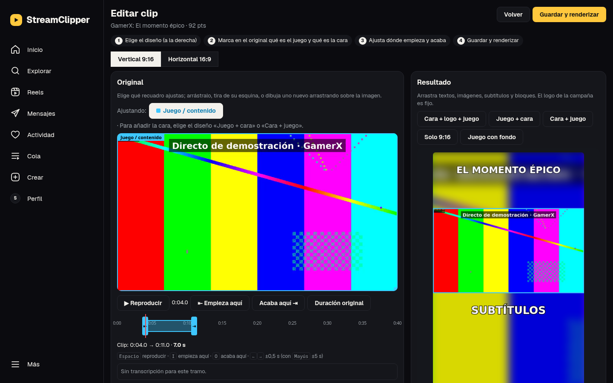
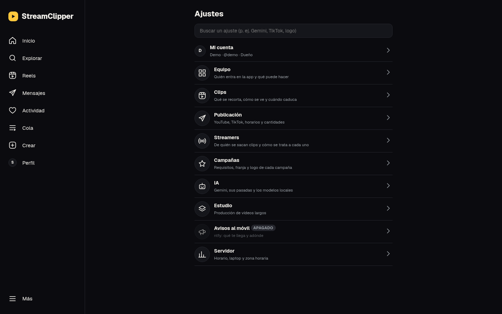

<picture>
  <source media="(prefers-color-scheme: dark)" srcset="docs/cabecera-oscuro.svg">
  
</picture>

StreamClipper watches the channels you pick, finds the moments worth posting, cuts them to 9:16 with the webcam and the game in frame, adds captions and your campaign's logo, and queues them for YouTube Shorts and TikTok. You review everything from a web panel that works on your phone. It runs on your own computer, so there's no per-minute bill and nobody else holds your videos.

I built it for my own clipping work and use it every day. This is the open part of that setup.

**[English](#what-it-does)** · **[Español](#qué-hace)** · **[Screenshots](#screenshots)** · **[Install](#install)**

## What it does

**Finds the moments.** Chat spikes, audio peaks, the "most replayed" curve and the transcript all count. If you'd rather have an AI choose, connect Claude, Gemini or any MCP client to the built-in MCP server and let it mark the moments on a schedule. You bring your own account; nothing is shared.

**Frames them for vertical.** Webcam on top, gameplay below, or full frame. It detects the webcam and remembers how you framed each streamer, so the next clip comes out the same way.

**Writes the text.** Word-by-word captions with Whisper, a hook on screen, a title and hashtags.

**Handles campaigns.** Each campaign keeps its logo, required hashtags, language and posting rules, and a clip that breaks them waits instead of going out.

**Publishes.** Upload queues for YouTube Shorts and TikTok with daily limits. Each user connects their own Google and TikTok apps.

**Learns what you skip.** Mark a clip as good or bad and say why. After a while it sets aside the ones you would have thrown out.

There's also a built-in editor (trim, reframe, layers, undo) and a server page in the style of btop that shows CPU per core, memory, network, disks and every process grouped by service.

## Qué hace

StreamClipper vigila los canales que elijas, encuentra los momentos que vale la pena publicar, los recorta en 9:16 con la webcam y el juego en cuadro, les pone subtítulos y el logo de tu campaña, y los deja en cola para YouTube Shorts y TikTok. Lo revisas todo desde un panel web que funciona en el móvil. Corre en tu propio equipo: no pagas por minuto de vídeo y tus vídeos no salen de tu casa.

- **Momentos:** picos de chat y de audio, la curva de «lo más visto» y la transcripción. O conecta tu propia IA (Claude, Gemini o cualquier cliente MCP) al servidor MCP incluido para que los marque ella.
- **Encuadre vertical:** detecta la webcam y recuerda cómo encuadraste a cada streamer.
- **Texto:** subtítulos palabra a palabra con Whisper, gancho en pantalla, título y hashtags.
- **Campañas:** logo, hashtags obligatorios, idioma y reglas; si un clip no las cumple, espera.
- **Publicación:** colas para YouTube Shorts y TikTok con límite diario, con tus propias apps de Google y TikTok.
- **Aprende de ti:** valora los clips y con el tiempo aparta los que habrías descartado.

## Screenshots

| Clips | Editor | Server |
|:--|:--|:--|
|  |  |  |
| **Phone** | **Upload queue** | **Settings** |
|  |  |  |

### New to this? / ¿Es tu primera vez?

Never used a terminal? Follow the step-by-step manual (in Spanish): [StreamClipper · Primeros pasos (PDF)](docs/manual/StreamClipper-Primeros-pasos.pdf). It takes you from a clean Windows, macOS or Linux computer to your first clip in about 20 minutes, and the app itself opens a «Primeros pasos» checklist on your first login.

¿Nunca has usado una terminal? Sigue el [manual paso a paso (PDF)](docs/manual/StreamClipper-Primeros-pasos.pdf): te lleva de un ordenador sin nada a tu primer clip en unos 20 minutos. Al entrar por primera vez, la propia app te abre la lista «Primeros pasos».

## Install

You need Node.js 22.13 or newer, FFmpeg and yt-dlp. Whisper (whisper.cpp) is optional and only needed for captions.

```bash
git clone https://github.com/2mingho/streamclipper.git
cd streamclipper/servidor
npm install
npm start
```

Open http://localhost:8790 and create your account. The first login becomes the owner. If FFmpeg or yt-dlp are missing, the server tells you which one when it starts.

Long videos and finished streams work out of the box: StreamClipper picks the best moments (AI marks if you connected one, otherwise YouTube's "most replayed" curve and audio peaks), downloads only those sections and turns each one into a clip. OpenShorts can be plugged in as an optional backend in Ajustes › Clips.

### Connect an AI / Conecta una IA

Clips come out without any AI, but titles, the on-screen hook and descriptions need one. Open **Ajustes › IA › Tu propio modelo**, pick a service, press **Ver modelos**, choose one and press **Guardar y probar**. Anything that speaks the OpenAI API works:

| Service | Address | Key |
|:--|:--|:--|
| [Ollama](https://ollama.com) (your computer) | `http://127.0.0.1:11434/v1` | no |
| [LM Studio](https://lmstudio.ai) (your computer) | `http://127.0.0.1:1234/v1` | no |
| llama.cpp `llama-server` | `http://127.0.0.1:8080/v1` | no |
| OpenRouter, OpenAI, DeepSeek, Mistral… | their API address | yes |

The address works with or without `/v1`. If the model runs on another machine, use that machine's IP instead of `127.0.0.1` (and start Ollama with `OLLAMA_HOST=0.0.0.0`). Tick **Entiende imágenes** for vision models so it can also check frames and find the webcam. Your model goes first; a free [Groq](https://console.groq.com/keys) or [Gemini](https://aistudio.google.com/apikey) key, set on the same page, works as backup.

**No AI account at all?** Use your Google account: open [Google AI Studio](https://aistudio.google.com/apikey), press **Create API key** and paste it in **Ajustes › IA › Gemini**. It's free, needs no Google Cloud project setup and no credit card (the free tier has daily limits; a few clips a day usually fit). The app walks you through it. Keys are stored in `~/.config/streamclipper/claves.env`, never in the database.

Los clips salen sin IA, pero el título, el gancho en pantalla y las descripciones la necesitan. Entra en **Ajustes › IA › Tu propio modelo**, elige el servicio, pulsa **Ver modelos**, elige uno y pulsa **Guardar y probar**. Vale cualquier servicio compatible con la API de OpenAI (tabla de arriba). Si el modelo corre en otro equipo, usa su IP en vez de `127.0.0.1`. Marca **Entiende imágenes** si el modelo tiene visión. Tu modelo va primero; una clave gratuita de Groq o Gemini, en la misma página, sirve de respaldo.

**¿No tienes ninguna cuenta de IA?** Usa tu cuenta de Google: entra en [Google AI Studio](https://aistudio.google.com/apikey), pulsa **Create API key** y pégala en **Ajustes › IA › Gemini**. Es gratis, sin configurar Google Cloud y sin tarjeta (el plan gratuito tiene límites diarios; para unos pocos clips al día suele bastar). La app te guía paso a paso.

To reach it from your phone, put it on [Tailscale](https://tailscale.com) and open the same address through your tailnet. A sample systemd unit is in `servidor/herramientas/`.

## What's not in this repository

Your data, your keys and your accounts. The database, the videos, the AI keys, the MCP secret and the YouTube and TikTok tokens are created on your machine and stay there. The repository only ships an example campaign.

## Coming next

A native Android app (Jetpack Compose) is in progress.

## Privacy

Anonymous usage telemetry is **off by default** and only turns on if the owner says yes. [TELEMETRY.md](TELEMETRY.md) lists every field. `STREAMCLIPPER_TELEMETRIA=0` or `DO_NOT_TRACK=1` turns it off for good. To report a bug, use **Más › Reportar un problema** in the app: it opens a pre-filled GitHub issue you can review first.

## Contributing

Issues and pull requests are welcome. If StreamClipper saves you editing time, a star helps other clippers find it.

## License

[AGPL-3.0](LICENSE)
