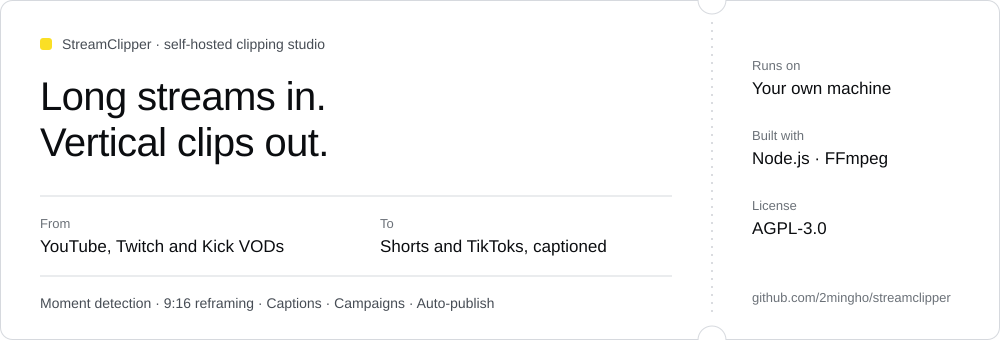
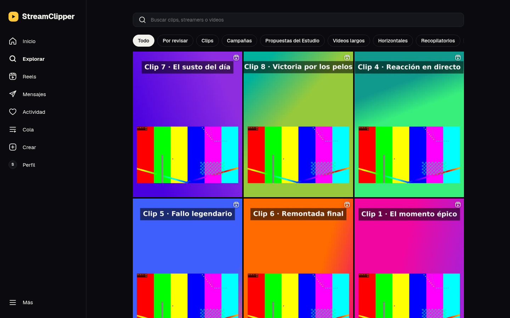
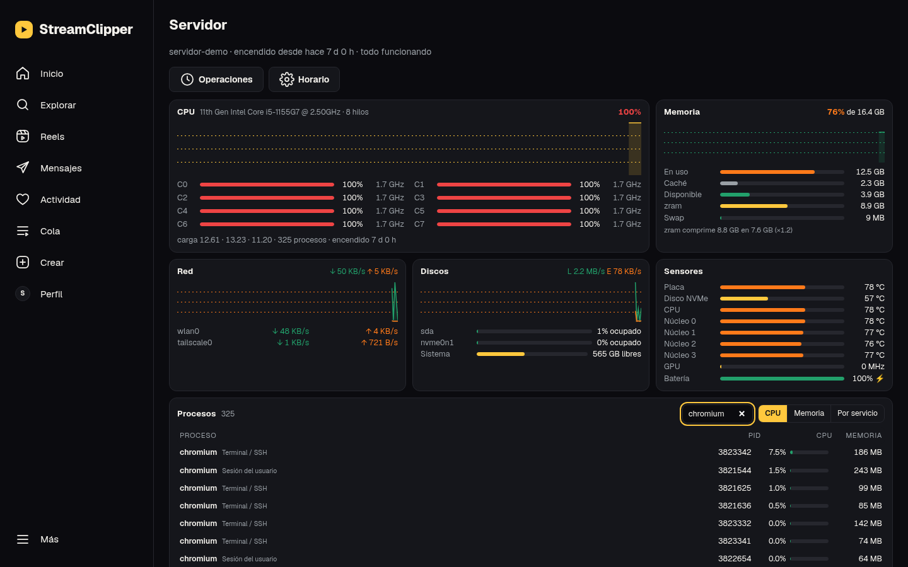

<picture>
  <source media="(prefers-color-scheme: dark)" srcset="docs/cabecera-oscuro.svg">
  
</picture>

StreamClipper watches the channels you pick, finds the moments worth posting, cuts them to 9:16 with the webcam and the game in frame, adds captions and your campaign's logo, and queues them for YouTube Shorts and TikTok. You review everything from a web panel that works on your phone. It runs on your own computer, so there's no per-minute bill and nobody else holds your videos.

I built it for my own clipping work and use it every day. This is the open part of that setup.

**[English](#what-it-does)** · **[Español](#qué-hace)** · **[Screenshots](#screenshots)** · **[Install](#install)**

## What it does

**Finds the moments.** Chat spikes, audio peaks, the "most replayed" curve and the transcript all count. If you'd rather have an AI choose, connect Claude, Gemini or any MCP client to the built-in MCP server and let it mark the moments on a schedule. You bring your own account; nothing is shared.

**Frames them for vertical.** Webcam on top, gameplay below, or full frame. It detects the webcam and remembers how you framed each streamer, so the next clip comes out the same way.

**Writes the text.** Word-by-word captions with Whisper, a hook on screen, a title and hashtags.

**Handles campaigns.** Each campaign keeps its logo, required hashtags, language and posting rules, and a clip that breaks them waits instead of going out.

**Publishes.** Upload queues for YouTube Shorts and TikTok with daily limits. Each user connects their own Google and TikTok apps.

**Learns what you skip.** Mark a clip as good or bad and say why. After a while it sets aside the ones you would have thrown out.

There's also a built-in editor (trim, reframe, layers, undo) and a server page in the style of btop that shows CPU per core, memory, network, disks and every process grouped by service.

## Qué hace

StreamClipper vigila los canales que elijas, encuentra los momentos que vale la pena publicar, los recorta en 9:16 con la webcam y el juego en cuadro, les pone subtítulos y el logo de tu campaña, y los deja en cola para YouTube Shorts y TikTok. Lo revisas todo desde un panel web que funciona en el móvil. Corre en tu propio equipo: no pagas por minuto de vídeo y tus vídeos no salen de tu casa.

- **Momentos:** picos de chat y de audio, la curva de «lo más visto» y la transcripción. O conecta tu propia IA (Claude, Gemini o cualquier cliente MCP) al servidor MCP incluido para que los marque ella.
- **Encuadre vertical:** detecta la webcam y recuerda cómo encuadraste a cada streamer.
- **Texto:** subtítulos palabra a palabra con Whisper, gancho en pantalla, título y hashtags.
- **Campañas:** logo, hashtags obligatorios, idioma y reglas; si un clip no las cumple, espera.
- **Publicación:** colas para YouTube Shorts y TikTok con límite diario, con tus propias apps de Google y TikTok.
- **Aprende de ti:** valora los clips y con el tiempo aparta los que habrías descartado.

## Screenshots

| Clips | Editor | Server |
|:--|:--|:--|
|  |  |  |
| **Phone** | **Upload queue** | **Settings** |
|  |  |  |

## Install

You need Node.js 22.13 or newer, FFmpeg and yt-dlp. Whisper (whisper.cpp) is optional and only needed for captions.

```bash
git clone https://github.com/2mingho/streamclipper.git
cd streamclipper/servidor
npm install
npm start
```

Open http://localhost:8790 and create your account. The first login becomes the owner. If FFmpeg or yt-dlp are missing, the server tells you which one when it starts.

To reach it from your phone, put it on [Tailscale](https://tailscale.com) and open the same address through your tailnet. A sample systemd unit is in `servidor/herramientas/`.

## What's not in this repository

Your data, your keys and your accounts. The database, the videos, the Groq key, the MCP secret and the YouTube and TikTok tokens are created on your machine and stay there. The repository only ships an example campaign.

## Coming next

A native Android app (Jetpack Compose) is in progress.

## Contributing

Issues and pull requests are welcome. If StreamClipper saves you editing time, a star helps other clippers find it.

## License

[AGPL-3.0](LICENSE)
