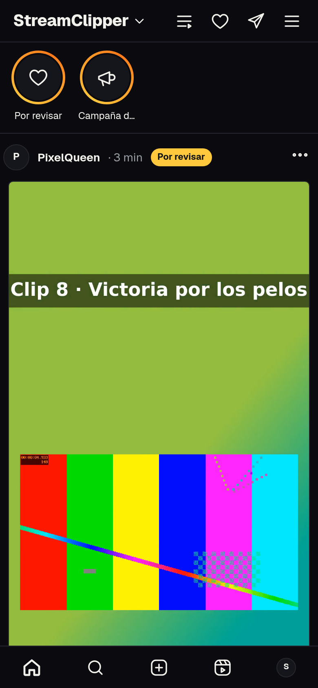
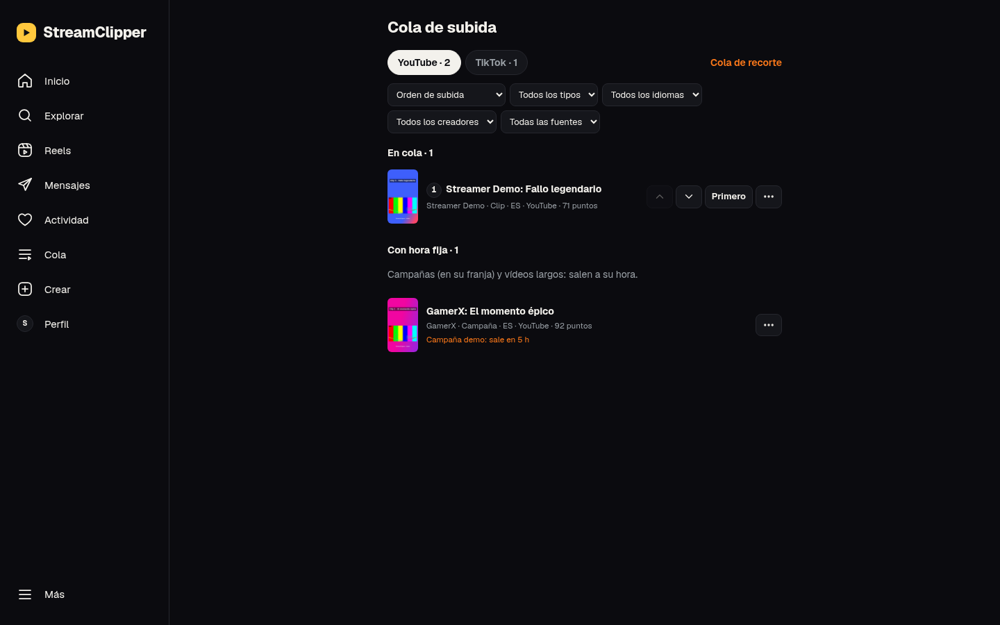

<div align="center">

# ✂️ StreamClipper

**Self-hosted AI clipping studio for streamers & clippers — turn long streams and VODs into vertical Shorts, Reels and TikToks, on your own server.**

**Estudio de clips con IA, autoalojado, para clippers y streamers: convierte directos y VODs largos en Shorts, Reels y TikToks verticales, en tu propio servidor.**

[English](#-english) · [Español](#-español) · [Screenshots](#-screenshots--capturas) · [Install](#-quick-install--instalación-rápida)


</div>

---

## 🇬🇧 English

**StreamClipper** is an open-source, self-hosted **stream clipping tool**: it watches the channels you choose (YouTube, Twitch, Kick…), finds the best moments, cuts them into **vertical 9:16 clips** with webcam + gameplay framing, word-by-word **captions**, hooks and your logo, and publishes them to **YouTube Shorts** and **TikTok** — while you review everything from a fast web panel on your phone.

Built for **clippers** running clipping campaigns (Content Rewards, Whop, Clipping.com-style programs) and for **streamers** who want their own highlight factory without paying per minute of video.

### ✨ Features

- 🎯 **Smart moment detection** — chat spikes, audio peaks, "most replayed" heatmaps and transcripts; or let **your own AI** (Claude, Gemini, ChatGPT…) mark the moments through the built-in **MCP server**.
- 📱 **Vertical reframing** — webcam + gameplay layouts, auto webcam detection, per-streamer learned framing.
- 💬 **Captions & hooks** — word-by-word subtitles (Whisper), on-screen hook text, titles and hashtags.
- 🏷️ **Campaign mode** — logos, required hashtags, language checks and posting rules per campaign.
- 🚀 **Auto-publish** — YouTube Shorts & TikTok queues with daily limits (each user connects **their own** Google/TikTok app — nothing is shared).
- ✏️ **Built-in editor** — trim, re-frame, layers, undo; renders in the background.
- 🧠 **Learns from you** — rate clips (good / bad + reason) and the pre-filter learns what you discard.
- 🖥️ **btop-style server dashboard** — live CPU per core, RAM, network, disks, sensors and processes grouped by service.
- 🔒 **Private by default** — runs on your machine; designed for Tailscale; the public internet only sees what you choose.

### ⚡ Quick install

```bash
git clone https://github.com/2mingho/streamclipper.git && cd streamclipper/servidor
npm install
npm start          # → open http://localhost:8790 and create your account
```

Requirements: **Node.js 22.13+**, **FFmpeg** and **yt-dlp** in your PATH. Optional: Whisper (whisper.cpp) for captions, a GPU laptop as accelerator, [Tailscale](https://tailscale.com) to reach it from your phone.

---

## 🇪🇸 Español

**StreamClipper** es una herramienta **open source y autoalojada para hacer clips de directos**: vigila los canales que elijas (YouTube, Twitch, Kick…), encuentra los mejores momentos, los recorta en **vertical 9:16** con webcam + juego, **subtítulos** palabra a palabra, gancho y tu logo, y los publica en **YouTube Shorts** y **TikTok**. Tú lo revisas todo desde un panel web rápido en el móvil.

Pensado para **clippers** que trabajan campañas de clipping (Content Rewards, Whop y similares) y para **streamers** que quieren su propia fábrica de highlights sin pagar por minuto de vídeo.

### ✨ Qué hace

- 🎯 **Detección de momentos** — picos de chat y de audio, «lo más visto» y transcripciones; o que **tu propia IA** (Claude, Gemini, ChatGPT…) marque los momentos a través del **servidor MCP** incluido.
- 📱 **Encuadre vertical** — diseños webcam + juego, detección de la webcam y encuadre aprendido por streamer.
- 💬 **Subtítulos y gancho** — subtítulos palabra a palabra (Whisper), texto en pantalla, títulos y hashtags.
- 🏷️ **Modo campaña** — logos, hashtags obligatorios, idioma y reglas de publicación por campaña.
- 🚀 **Publicación automática** — colas para YouTube Shorts y TikTok con límite diario (cada usuario conecta **su propia** app de Google/TikTok; no se comparte nada).
- ✏️ **Editor integrado** — recortar, reencuadrar, capas, deshacer; renderiza en segundo plano.
- 🧠 **Aprende de ti** — valora los clips (sirve / no sirve + motivo) y el prefiltro aprende lo que descartas.
- 🖥️ **Panel del servidor estilo btop** — CPU por núcleo, memoria, red, discos, sensores y procesos por servicio, en vivo.
- 🔒 **Privado por defecto** — corre en tu equipo; pensado para Tailscale; desde internet solo se ve lo que tú decidas.

### ⚡ Instalación rápida

```bash
git clone https://github.com/2mingho/streamclipper.git && cd streamclipper/servidor
npm install
npm start          # → abre http://localhost:8790 y crea tu cuenta
```

Necesitas **Node.js 22.13+**, **FFmpeg** y **yt-dlp** en el PATH. Opcional: Whisper (whisper.cpp) para subtítulos, una laptop con GPU como acelerador y [Tailscale](https://tailscale.com) para entrar desde el móvil.

---

## 📸 Screenshots / Capturas

| Clips | Editor | Server (btop) |
|---|---|---|
|  |  |  |

| Mobile / Móvil | Upload queue / Cola de subida | Settings / Ajustes |
|---|---|---|
|  |  |  |

---

## 🤖 AI assistants via MCP / Asistentes de IA por MCP

StreamClipper ships an **MCP server** (`mcp/`). Connect it to Claude, Gemini or any MCP client with **your own secret URL**, and schedule a task in your assistant to mark the best moments of new videos. *Each user sets this up with their own account; StreamClipper never ships keys.*

StreamClipper incluye un **servidor MCP** (`mcp/`). Conéctalo a Claude, Gemini o cualquier cliente MCP con **tu propia URL secreta** y programa una tarea en tu asistente para que marque los mejores momentos de los vídeos nuevos. *Cada usuario lo configura con su propia cuenta; StreamClipper no incluye claves.*

## 📲 Native app / App nativa

A native **Android app** (Jetpack Compose, Material You) is in the works. / Hay una **app nativa para Android** en camino.

## ⭐ Support / Apoya el proyecto

If StreamClipper saves you hours of editing, **a star ⭐ helps other clippers find it**. Issues and PRs welcome.

Si StreamClipper te ahorra horas de edición, **una estrella ⭐ ayuda a que otros clippers lo encuentren**. Issues y PRs bienvenidos.

## 📄 License / Licencia

[AGPL-3.0](LICENSE)

<sub>Keywords: stream clipper, AI clipping tool, auto clip generator, YouTube Shorts maker, TikTok clips, Twitch clips, Kick clips, vertical video, 9:16 reframe, highlights generator, clipping campaigns, content rewards, self-hosted, open source, MCP server, Claude, Gemini · clips de directos, hacer clips automáticamente, generador de shorts, clipper, campañas de clipping.</sub>
